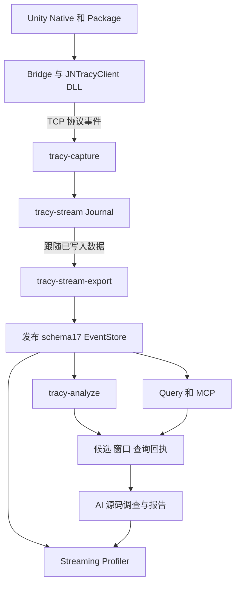
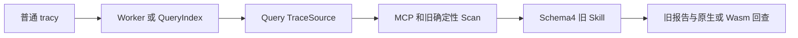

# 系统架构与关键数据链路

系统把 Unity 内部可观测事件传入 Tracy，再提供确定性统计、面向 AI 的证据查询和人工可回查的报告。开发时最重要的是保持每层的身份、时间和质量含义一致。

## 模块职责

| 层次 | 主要组件 | 输入与输出 |
|---|---|---|
| 游戏与引擎语义 | Unity Native、JNRenderPipeline、C#/Lua、资源系统 | 帧、函数作用域、Job、Pass、资源和 I/O 的业务语义 |
| 采集桥接 | JNTracyProfilerBridge、Job/Gfx/D3D12 Bridge、JNGame.Tracy | 统一 C ABI、稳定身份、配置准入、低成本记录 |
| 单一 Client | JNTracyClient.dll | 将各 producer 的记录转换为 Tracy 协议与 JN 扩展 |
| 录制 | tracy-capture、Capture GUI | 原始 journal、正常排空、状态与质量记录 |
| 访问存储 | EventStore、Worker、QueryIndex | 对不同介质提供可检查的读取路径 |
| 查询与统计 | QueryService、MCP、tracy-analyze、FrameTriage | 数值事实、候选、窗口、关系与质量 |
| 调查与交付 | Skill、源码快照、原生视图、报告 | 解释、反证、操作建议、复测标准和定位入口 |

## 当前 Stream 主链



录制阶段同时存在原始 journal 与派生事件库。停止后由 capture 完成排空，builder 完成 store，控制器检查原始输入与 store summary 身份。成功结束会把 task 的 final 指向 stream；不是必须继续生成完整 .tracy。[Controller.cpp:244](../capture-gui/src/Controller.cpp#L244)

## 普通 Trace 兼容链



SessionManager 对有当前 EventStore 的 stream 优先使用 EventStoreTraceSource；没有对应 store 的 stream 走 SegmentTraceSource 重放；普通 .tracy 根据 preferIndex 选择索引或 Worker。**通用 Query 可以退回重放，并不表示 tracy-analyze 也可以。** analyze 要求已发布的当前 schema store。[TracySessionManager.cpp:81](../query/src/TracySessionManager.cpp#L81) [analyze.cpp:249](../query/src/analyze.cpp#L249)

## 七条需要分别维护的链路

1. **CPU 与帧**：PlayerLoop/EditorTick/Render/Present → Frame identity → CPU Zone 与层级。帧集合、根区间、连接代际和不完整边界共同决定统计是否可解释。
2. **Job 与等待**：调度 → Ready/Dispatch → Worker Slice/Steal/ActiveHelp → 完成或等待。Job 需要 handle/generation 与 Trace 身份；时间重叠不能替代依赖关系。
3. **GPU**：Managed/Native Pass → CommandBuffer 实际回放 → D3D12 CommandList → Queue/Segment/timestamp → Query。CPU 构建命令的耗时与 GPU 执行时间分开。
4. **资源与显存**：分配、逻辑资源、Heap/Range、资源名与用途 → Frame/Pass 引用 → 统计和归因。Catalog、内存注册表与 Detailed Evidence 是不同数据来源。
5. **I/O 与脚本**：Managed LoadAsset/Scope → 请求或源码栈身份 → Native 操作/线程事件 → 结果、错误或取消。
6. **存储与查询**：原始 stream → 有效前缀 → store/快照/索引 → 查询响应。格式版本、完整性和缓存身份不能混为一个字段。
7. **分析与回查**：原生全量统计 → 调查义务 → 精确样本与源码 → 结论与复测 → 同一实例原生图片及链接。

各链的实现入口分别见 [引擎](03-unity-engine-changes.zh-CN.md)、[Package](04-packagerepo-changes.zh-CN.md)、[存储](06-storage-formats-and-long-capture.zh-CN.md) 和 [Skill](09-skill-stream-workflow.zh-CN.md)。

## 不能跨层替代的判断

- producer 开关开启不证明数据完整落盘；还要检查 dropped、overflow、mismatch、generation 和域状态。
- store 发布成功不证明所有源域完整；它可能忠实保存了有缺口的原始录制。
- 候选枚举完整不证明所有候选都已源码深查，更不证明根因或优化收益。
- 图能显示不证明定位正确；定位正确不证明网页交互或显示清晰度已验收。
- 当前源码能解释机制，不证明它就是捕获使用的二进制实现。

## 一次分析的最小身份链

```text
三仓提交与 dirty patch
→ Player DLL/PDB、包映射与配置
→ 原始录制 SHA、store schema/revision
→ 实际 EXE SHA、策略和算法版本
→ 帧集合/owner/事件 ref、窗口与请求回执
→ 源码快照、判断强度、视图定位与报告
```

这条链也是维护者排查“同一报告为什么给出不同数字”的顺序：先校验身份和统计口径，再判断查询或解释是否有问题。
