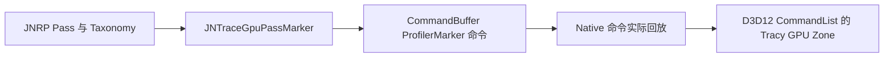

# PackageRepo 代码改动与维护说明

目标分支 feature/Pack-JNTracy，HEAD `0ac6735ce3ca84f7ffbe2dd0cfcfa8acbfa2ed91`。相对与 origin/t3/development 的共同祖先 `92f1ededb40cfada15df61411a5ad0a7d2ce12eb`，共 99 个变更文件、10,454 行新增、44 行删除；其中 36 个是 Unity .meta。完整清单见 [附录](appendices/packagerepo-file-changes.zh-CN.md)。

## 1 代码组织

| 范围 | 职责 |
|---|---|
| com.jngame.tracy/Runtime | Native ABI 访问、Marker/Scope、脚本栈、GPU Pass、Catalog、I/O、Memory、Lock、Plot、FrameImage、GC 和 Player 自动登录 |
| com.jngame.tracy/Editor | Editor 自动登录、数据与栈验证、ILPostProcessor |
| com.jngame.tracy/Tools | Player 自动采集和自动化静态检查 |
| com.jngame.render-pipelines | JNRP Pass 语义、RenderGraph 资源、VG/VSM、最终颜色帧图像 |
| com.jngame.assets-pipeline | Managed 资源请求和 Native I/O 的关联、结束/错误/取消 |
| com.unity.render-pipelines.core | CPU inline 与 CommandBuffer/GPU sampler 身份分离 |

com.jngame.tracy 的包版本为 0.1.0，程序集通过 versionDefines 产生 ENABLE_JN_TRACY_MANAGED，autoReferenced=false；消费程序集需要明确引用与依赖，不能只复制几个 .cs 文件。[JNGame.Tracy.asmdef:1](C:/workflow/PackageRepo/com.jngame.tracy/Runtime/JNGame.Tracy.asmdef:1)

## 2 Managed 与 Native 的边界

JNTracyRuntime 校验 ABI 1.8、ConfigHash 和 Client 状态；Managed 代码只消费由 Native 拥有的 Client，没有全局 Startup/Shutdown 入口。Unavailable、断连和宏关闭应允许业务正常运行；Package 中不能再放一份独立 Client 实例。[JNTracyRuntime.cs:124](C:/workflow/PackageRepo/com.jngame.tracy/Runtime/JNTracyRuntime.cs:124) [JNTracyNative.cs:1](C:/workflow/PackageRepo/com.jngame.tracy/Runtime/JNTracyNative.cs:1)

JNTraceMarker 在冷路径保存稳定 UTF-8 名称、源码位置和注册句柄，Scope 在热路径记录作用域。应缓存稳定 Marker，避免每帧构造带动态资源名的大量 Marker。动态实体信息与低基数定义的用途分开。[JNTraceMarker.cs:123](C:/workflow/PackageRepo/com.jngame.tracy/Runtime/JNTraceMarker.cs:123)

## 3 脚本栈和 IL 后处理

SourceStack、ScriptStack 和 Lua 接口补足脚本调用来源；Native unwind 与 C#/Lua 源码栈仍是不同证据。ILPostProcessor 使用 Mono.Cecil 为指定方法插入追踪逻辑。当前覆盖以实际属性、规则和编译条件为准，不能因配置写了 Allowlist 就声称所有 C# 方法都被插桩。[JNTraceSourceStack.cs:1](C:/workflow/PackageRepo/com.jngame.tracy/Runtime/JNTraceSourceStack.cs:1) [JNTraceSourceStackILPostProcessor.cs:1](C:/workflow/PackageRepo/com.jngame.tracy/Editor/CodeGen/JNTraceSourceStackILPostProcessor.cs:1)

改变后处理时要检查程序集引用、方法异常退出、泛型和状态机边界、符号信息以及热路径分配；新的覆盖范围应先通过专项开销与语义测试再进入常规采集。

## 4 GPU Pass 标记链

JNTraceGpuPassMarker 的注册与 UTF-8 转换位于冷路径；Begin/End 向 CommandBuffer 写已有 ProfilerMarker 命令。不能把 C# 发出命令时的线程和时间当成 GPU 执行位置。[JNTraceGpuPassMarker.cs:1](C:/workflow/PackageRepo/com.jngame.tracy/Runtime/JNTraceGpuPassMarker.cs:1) [JNRPGpuPassRegistry.cs:1](C:/workflow/PackageRepo/com.jngame.render-pipelines/Runtime/BuiltIn/RenderPipeline/JNRPGpuPassRegistry.cs:1)

ProfilingScope 的修改是重要正确性约束：CPU inline sampler 使用 RenderPass.CPU 前缀，command/GPU sampler 使用独立身份。Unity 按名称复用 Marker，若同一身份被提升为 GPU Sample，回调会产生错误的 CPU 嵌套链。End 的次序与 CommandBuffer 回放也必须匹配。[ProfilingScope.cs:21](C:/workflow/PackageRepo/com.unity.render-pipelines.core/Runtime/RenderPipeline/ProfilingScope.cs:21)

## 5 RenderGraph 与 Catalog

RenderGraph 的 Texture、ComputeBuffer、ResourceFactory/Resources、Aliasing 与 PassBuilder 提供资源创建、绑定、别名和生命周期的语义。GPU Catalog 则将这些语义连接到 Native 指针、分配和使用关系。读取 NativePointer 前会检查 Catalog 是否启用，维护时仍需注意获取指针可能引起主渲染线程同步。[JNTraceGpuCatalog.cs:1](C:/workflow/PackageRepo/com.jngame.tracy/Runtime/JNTraceGpuCatalog.cs:1) [RDGResourceTexture.cs:334](C:/workflow/PackageRepo/com.jngame.render-pipelines/Runtime/BuiltIn/RenderGraph/RDGResourceTexture.cs:334) [RDGResourceComputeBuffer.cs:138](C:/workflow/PackageRepo/com.jngame.render-pipelines/Runtime/BuiltIn/RenderGraph/RDGResourceComputeBuffer.cs:138) [RDGResources.cs:1](C:/workflow/PackageRepo/com.jngame.render-pipelines/Runtime/BuiltIn/RenderGraph/RDGResources.cs:1)

VG 专用目录进一步提供页面/Buffer 等资源信息；VSM、ScreenProbe、TSR、FinalBlit 等具体 Pass 在各自代码中接入。加入新 Pass 时优先确认既有 registry 和 ProfilingScope 已能表达的内容，再补专用结构化字段，不重复记录同一作用域。[JNVirtualGeometryTracyCatalog.cs:1](C:/workflow/PackageRepo/com.jngame.render-pipelines/Runtime/BuiltIn/VirtualGeometry/Render/JNVirtualGeometryTracyCatalog.cs:1) [JNRenderPipeline.cs:85](C:/workflow/PackageRepo/com.jngame.render-pipelines/Runtime/BuiltIn/RenderPipeline/JNRenderPipeline.cs:85)

## 6 FrameImage

最终颜色阶段提交或取消已排队的 FrameImage 副本；Managed 侧与 Native pool/readback 配合，按配置间隔采样。图片要保留对应帧身份，不能以文件生成顺序猜帧号。当前帧图像分辨率、采样间隔、是否包含最终合成依赖配置与实际渲染路径。[JNTraceFrameImage.cs:1](C:/workflow/PackageRepo/com.jngame.tracy/Runtime/JNTraceFrameImage.cs:1) [JNRenderPipeline.cs:85](C:/workflow/PackageRepo/com.jngame.render-pipelines/Runtime/BuiltIn/RenderPipeline/JNRenderPipeline.cs:85)

## 7 资源加载 I/O

LoadTaskQueue 给异步资源请求创建 tracyIoRequestId，调用 Begin/Start，并通过 PushParent/RestoreParent 让 Native 子请求连接到 Managed 父请求。异常分支发送 Error，完成分支根据结果发送 Complete/Error；池回收时仍未结束的请求发送 Cancel 并清零。[ResourceSystem.LoadTaskQueue.cs:95](C:/workflow/PackageRepo/com.jngame.assets-pipeline/Runtime/ResourceSystem/ResourceSystem.LoadTaskQueue.cs:95) [ResourceSystem.cs:126](C:/workflow/PackageRepo/com.jngame.assets-pipeline/Runtime/ResourceSystem/ResourceSystem.cs:126) [JNTraceIO.cs:1](C:/workflow/PackageRepo/com.jngame.tracy/Runtime/JNTraceIO.cs:1)

这里的 try/finally 保护的是追踪上下文恢复。维护时要覆盖：请求启动异常、资源为空、取消、对象池复用，以及异步回调是否还引用旧请求身份。不要为统计方便改变业务加载和取消行为。

## 8 自动登录与采集工具

Editor 和 Player 分别有自动登录入口，支持项目特定的用户、服务地址、超时和稳定帧控制。自动采集脚本负责运行与采集衔接；它依赖真实项目业务就绪，不能把 Init 场景稳定或进程存在当作成功。[JNTracyT3AutoLogin.cs:1](C:/workflow/PackageRepo/com.jngame.tracy/Editor/JNTracyT3AutoLogin.cs:1) [JNTracyT3PlayerAutoLogin.cs:1](C:/workflow/PackageRepo/com.jngame.tracy/Runtime/JNTracyT3PlayerAutoLogin.cs:1) [Invoke-JNTracyPlayerAutoCapture.ps1:1](C:/workflow/PackageRepo/com.jngame.tracy/Tools/Invoke-JNTracyPlayerAutoCapture.ps1:1)

N20/N21 曾误判成功，N22B 改为业务初始化、当前 loginAdapter、player/space、业务场景加载和连续稳定帧检查。具体案例与运行流程见 [采集手册](05-capture-and-autologin.zh-CN.md)。

## 9 修改与交付注意事项

- package.json、asmdef、versionDefines 和相应 .meta 需要与源码一并交接。
- 项目的 manifest 与 packages-lock 决定实际编译的包，源码根目录存在不代表项目正在使用它。
- 若只改 Package C#，仍需生成同代 GameAssembly/metadata；序列化字段或资源契约改变可能超出 scripts-only 范围。
- 引擎 ABI 与 Package 预期同时变化时，按协同构建处理。
- 报告源码应绑定捕获时的实际包版本；当前 checkout 只用于解释现有机制时，要保持判断层级。
