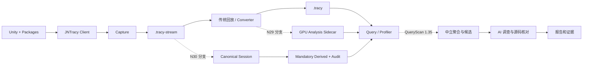

> 历史归档：2026 年 9 月文档中心快照。当前版本与操作入口见 [文档首页](../../../README.zh-CN.md)。原文中的“当前”、完成状态、版本与源码行号均指原记录时点；链接已按本次目录整理，未找到的旧目标保留为文字引用。

# 系统总览与模块架构

> 首版：2026-09-07｜用途：开发知识与跨对话协作｜事实以标注来源和版本为限。
> [返回文档入口](../README.md) · [当前状态](../STATUS.md) · [来源索引](../08-references/source-index.md)

## 目标与边界

本系统通过 JN Unity 插桩采集游戏运行事实，由 Tracy 存储和查询，再由 AI 结合确定性统计、事件关系和对应版本源码解释性能问题。“AI 性能分析”指 AI 辅助分析游戏性能，不专指模型推理性能。

当前历史部署与主要验收环境是 Windows x64、D3D12、Graphics Jobs Off。Editor、IL2CPP Player、不同采集档位和不同代码分支各有验证范围，不能相互代替。[S01](../08-references/source-index.md#s01) [S17](../08-references/source-index.md#s17)

## 组件职责

| 组件 | 职责 | 主要输出 | 下游依赖 |
|---|---|---|---|
| jnunity | CPU/Render/Job、原生 GPU、分配、I/O 等插桩及 JNTracy Client | 事件、身份、调用点、关系与质量计数 | 配套 Protocol/ABI |
| PackageRepo | Managed、CommandBuffer/RenderGraph 语义、逻辑资源与来源信息 | Managed 事件与 Native Bridge 调用 | 配套引擎接口及编译开关 |
| tracy-capture | 连接目标、接收事件、持续写 Journal、正常排空 | .tracy-stream、日志、结束状态 | 目标 Client、协议 |
| Converter / Session Builder | 回放与持久化；特定分支构建派生索引 | .tracy、N29 sidecar 或 N30 Session | 工具版本与输入完整性 |
| Tracy Query | 读取事实、检查质量、分页查询；QueryScan 分支新增原生扫描与候选 | MCP 结果、扫描状态和候选清单 | 输入格式、Schema、有效域 |
| Tracy Profiler | 人工查看 Timeline、GPU/Memory 等证据 | 可复核视图 | GUI 分支和数据后端 |
| diagnose-jn-unity-tracy | 调用查询、调查候选、核对源码、维护状态和报告 | Markdown 报告、证据附件、恢复记录 | 安装/草案版本对应的查询合同 |
| 本文档中心 | 记录系统、版本、操作与决策 | 可追溯的开发知识 | 原始设计、Git 快照和验收记录 |

模块责任参考 [S01](../08-references/source-index.md#s01) [S07](../08-references/source-index.md#s07)。以上为综合架构说明，不表示所有分支均具备表内全部能力。

## 两条必须分开理解的数据路径

传统 .tracy 侧重完整 Worker 数据模型。N29 将 GPU Resource 分析结果移入可持久化 sidecar；N30 进一步把全域事实组织成 Canonical shards，派生索引由事实重建。N30 目标是避免将完整大 Trace 和 GPU Snapshot 常驻内存；能否满足要求仍以具体验收为准。[S19](../08-references/source-index.md#s19) [S20](../08-references/source-index.md#s20) [S21](../08-references/source-index.md#s21) [S22](../08-references/source-index.md#s22)

## 事实、统计与解释的责任

1. 采集端证明“观测了什么”，同时记录缺失、丢弃和未解析状态。
2. 存储/转换端证明“保存了什么、转换是否引入缺失”。
3. Query 证明“统计与候选如何计算”，保留 Trace 和算法身份。
4. AI 说明“这些事实支持什么解释”，提出可检验假设，不能把候选直接改写为根因。
5. 报告将结论连接到请求、响应、事件、源码和验收证据。

QueryScan 的职责划分是新设计；已安装 1.x 工作流不能被描述为已经完成该迁移。[S07](../08-references/source-index.md#s07) [S27](../08-references/source-index.md#s27) [S28](../08-references/source-index.md#s28)

## 阅读顺序

先读 [能力矩阵](capabilities.md) 和 [数据契约](contracts.md)，再按目标选择 [关键链路目录](../02-chains/README.md)。涉及实际运行前先读 [分支地图](../04-branches/README.md) 和 [操作手册](../05-operations/runbook.md)。
