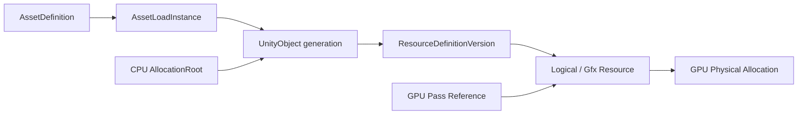

> 历史归档：2026 年 9 月文档中心快照。当前版本与操作入口见 [文档首页](../../../README.zh-CN.md)。原文中的“当前”、完成状态、版本与源码行号均指原记录时点；链接已按本次目录整理，未找到的旧目标保留为文字引用。

# 链路 05：资源引用、生命周期与显存归因

> 首版：2026-09-07｜用途：开发知识与跨对话协作｜事实以标注来源和版本为限。
> [返回文档入口](../README.md) · [当前状态](../STATUS.md) · [来源索引](../08-references/source-index.md)

## 两类互补能力

N27 GPU Catalog 回答 GPU Pass 使用了哪些逻辑/原生资源、视图、范围和物理分配。N28 ResourceGraph 的目标则把这些节点接到 Unity Object、Asset 和 CPU Allocation 来源。不能把前者的功能通过表述成后者已经在主线完整交付。[S17](../08-references/source-index.md#s17) [S18](../08-references/source-index.md#s18)

上图是 N28 统一证据链目标；每条边是否存在必须由相应 Trace 的 typed relation 和质量状态证明。

## 生命周期合同

- 逻辑句柄、原生指针或 Unity Object ID 可能重用，关联要包含 generation/版本及有效期。
- 连接时 Bootstrap 描述当前存活状态，连接前已经结束的历史事实不可补造。
- Delta Journal 记录连接后的变化；Bootstrap 和增量的闭合完整性必须验证。
- placed/alias 子资源不能按容量再次计入根分配总量。
- Pass working set 表示访问范围，不等于独立拥有那份物理内存。

依据 [S18](../08-references/source-index.md#s18) [S17](../08-references/source-index.md#s17)。精确显存口径见 [指标文档](../06-quality/metrics.md)。

## N31 为什么单独成立

N31 计划记录 Catalog On/Off 历史差异及六类成本来源：未连接仍构造名称/哈希/Native Pointer；每帧 Reset 导致 Unbind/Bind；slot 被误当生命周期；重复状态逐次跨 P/Invoke；Native 逐事件原子/复制/page 发布；成本窗口不完整。

修复目标是保留真实逐帧语义变化、抑制重复状态、降低未连接与已连接成本，并使逻辑记录和 Journal 增长受控。目标阈值属于计划，不是本次已达成结果。[S05](../08-references/source-index.md#s05)

## 查一条资源问题的顺序

1. 校验 Catalog generation 和 producer quality。
2. 固定目标时间、Frame/Pass 和 Resource generation。
3. 从 Pass use 找 View/Range、Logical/Gfx Resource 及物理 Allocation。
4. 去重所有权与重叠区间，核对是否同时存活。
5. 需要业务来源时再查 ResourceGraph 的 Object/Asset/CPU 链。
6. 区分“关系缺失”“资源不存在”“查询失败”和“域不受支持”。

N29/N30 优化该查询的存储与派生读取；N31 优化采集端生命周期与成本，属于不同改动面。[S19](../08-references/source-index.md#s19) [S21](../08-references/source-index.md#s21) [S05](../08-references/source-index.md#s05)
